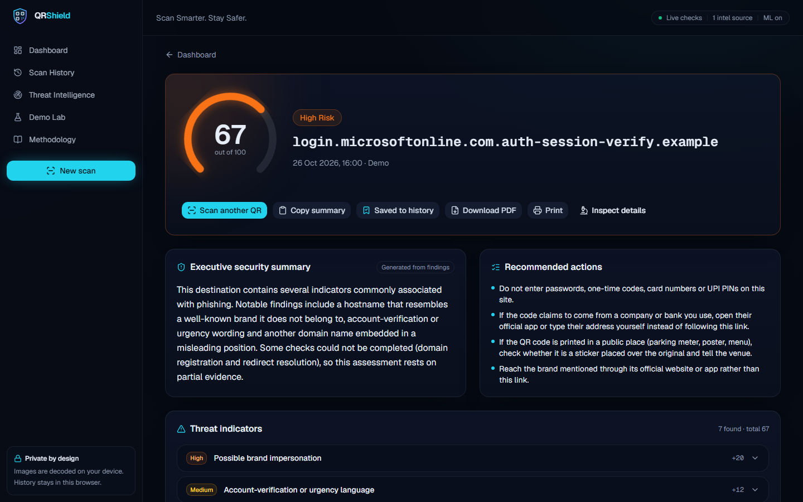
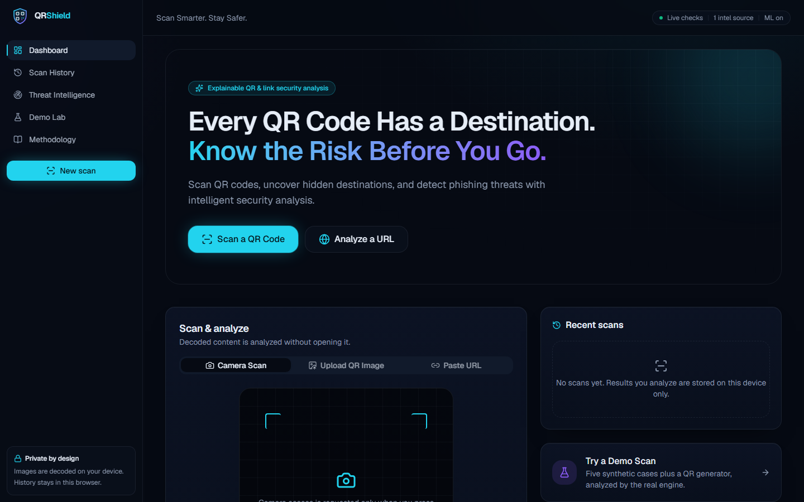
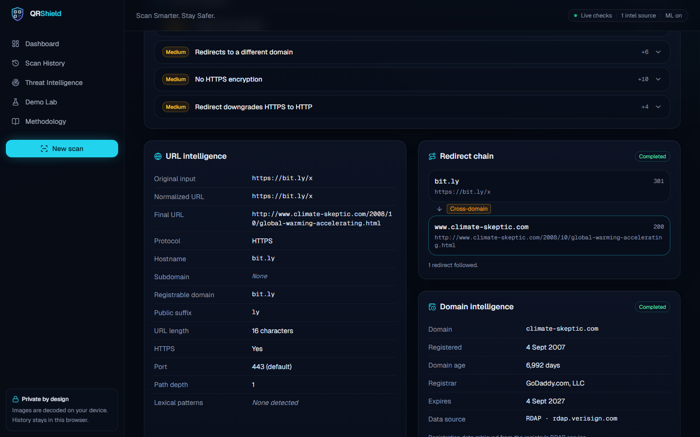
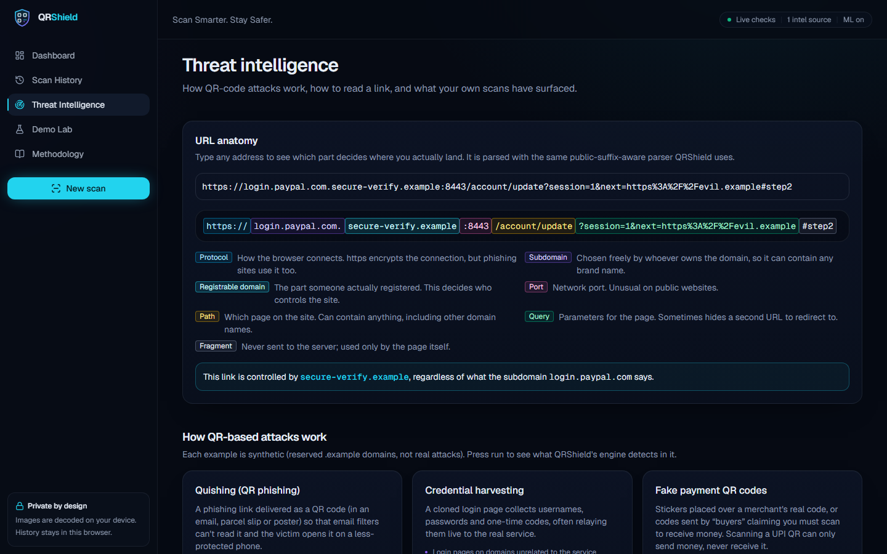
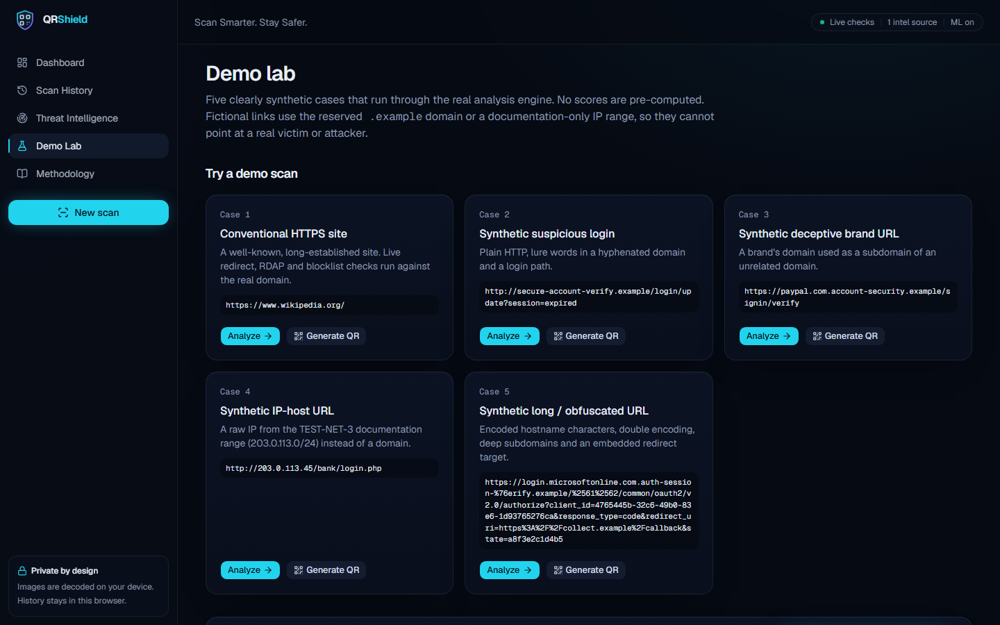
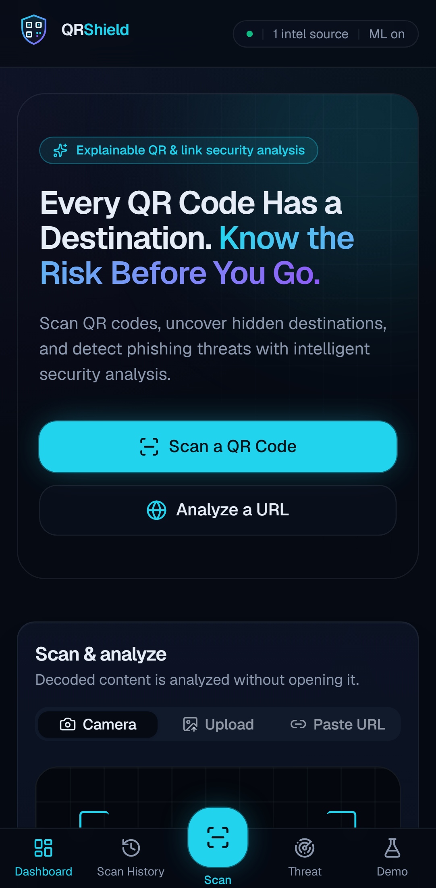
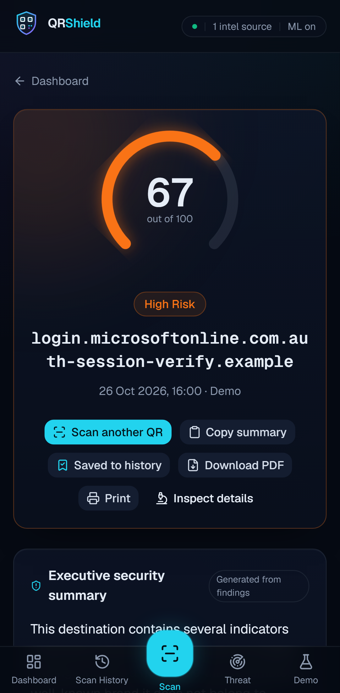

<div align="center">


# QRShield

**Scan smarter. Stay safer.**

Every QR code has a destination. QRShield shows you the risk before you go: an explainable security report on any QR code or link, **without opening it**.

[**Live demo →**](https://qrshieldmdp.vercel.app) &nbsp;·&nbsp; [Documentation](docs/README.md) &nbsp;·&nbsp; [How the score works](docs/scoring.md) &nbsp;·&nbsp; [Security design](docs/security-design.md)

[](https://github.com/darkaimzzz/qrshield/actions/workflows/ci.yml)


[](LICENSE)



</div>

---

## Why

QR codes hide their destination. Attackers exploit that with **quishing**:

- stickers over parking-meter codes;
- fake payment QR codes;
- "re-verify your account" codes in emails that slip past link filters.

QRShield decodes the code on your device, then a hardened server inspects the link: its structure, look-alike brands, redirects, domain age and threat lists. The result is a **0–100 risk score in which every point is tied to visible evidence**, plus a separate, genuinely trained machine-learning estimate.

## Features

|                             |                                                                                                                                                                    |
| --------------------------- | ------------------------------------------------------------------------------------------------------------------------------------------------------------------ |
| 📷 **Three ways in**        | Live camera scanning, on-device image decoding (choose between several codes in one image), or paste a URL                                                         |
| 🔍 **Real analysis**        | Public-suffix-aware parsing, lexical red flags, brand impersonation (typosquats, homoglyphs, mixed scripts), redirect chains, RDAP domain age, phishing blocklists |
| 🛡️ **SSRF-safe by design**  | Every hop re-validated, private/metadata IPs blocked at DNS time, sockets pinned to vetted addresses, header-only requests ([details](docs/security-design.md))    |
| 📊 **Explainable score**    | Deterministic weighted evidence; the score equals the sum of the listed contributions ([weights](docs/scoring.md))                                                 |
| 🧠 **Honest ML**            | Logistic regression trained on 219k real hostnames (ROC-AUC 0.906 on held-out domains), shown separately and labelled uncalibrated ([model card](ml/DATASET.md))   |
| 💬 **Plain-English report** | Grounded summary, contextual recommendations, optional guarded LLM rewording                                                                                       |
| 🧾 **Export**               | PDF report, print stylesheet, copyable summary, raw JSON inspector                                                                                                 |
| 🔒 **Private**              | Images never leave the device; history lives only in your browser; no accounts                                                                                     |
| 💳 **Beyond URLs**          | UPI payment, Wi-Fi, phone and vCard codes are decoded and explained, never executed                                                                                |
| 🎓 **Learn**                | Interactive URL anatomy, nine attack explainers that run the real engine, a demo lab with a QR generator                                                           |

<table>
  <tr>
    <td width="50%"></td>
    <td width="50%"></td>
  </tr>
  <tr>
    <td align="center"><sub>Dashboard: camera, upload or paste</sub></td>
    <td align="center"><sub>A real bit.ly redirect, resolved server-side, with RDAP data</sub></td>
  </tr>
  <tr>
    <td></td>
    <td></td>
  </tr>
  <tr>
    <td align="center"><sub>URL anatomy and attack explainers</sub></td>
    <td align="center"><sub>Demo lab: five synthetic cases plus a QR generator</sub></td>
  </tr>
</table>

<p align="center">
  
  &nbsp;&nbsp;
  
</p>

## How it works

```
Phone / browser                                   QRShield server (Node)
───────────────                                   ──────────────────────
camera ─┐                                         POST /api/analyze  → NDJSON progress stream
upload ─┼─► decode on device ─► classify ─► URL ─►   1. parse + lexical + impersonation
paste ──┘          │                                  2. redirects  (SSRF-hardened, header-only)
                   └─► UPI / Wi-Fi / text:            3. RDAP domain age   ┐ in parallel
                       shown inert, never run         4. threat intel      ┘
                                                      5. weighted score + ML estimate
report ◄── history (localStorage) ◄───────────────    6. grounded explanation
```

Each progress stage turns green only when the real operation finishes. A check that couldn't run is shown as **skipped / failed / not checked**, never as passed. Read more in [Architecture](docs/architecture.md).

| Example                                                             | Score           | Why                                                                         |
| ------------------------------------------------------------------- | --------------- | --------------------------------------------------------------------------- |
| `https://www.wikipedia.org/`                                        | **0** Low       | Nothing detected; domain 9,417 days old; not on blocklists                  |
| `https://bit.ly/x`                                                  | **32** Moderate | Shortener → different domain → plain-HTTP destination                       |
| `https://paypal.com.account-security.example/signin/verify`         | **42** Moderate | Brand in subdomain, misleading structure, lure words                        |
| `http://203.0.113.45/bank/login.php`                                | **46** Moderate | Raw IP host, no HTTPS, lure words; redirect probe refused (not a public IP) |
| `https://login.microsoftonline.com.auth-session-%76erify.example/…` | **67** High     | Microsoft look-alike, encoded hostname, embedded redirect, very long        |

> A low score means few warning signs were found, **not** that a site is guaranteed safe. No automated tool can promise that. See [limitations](docs/faq.md).

## Quick start

```bash
git clone https://github.com/darkaimzzz/qrshield.git
cd qrshield
npm install        # Node ≥ 20.9
npm run dev        # → http://localhost:3000
```

No API keys or database are needed. Optional integrations (Google Safe Browsing, URLhaus, OpenPhish, an OpenAI-compatible LLM) are configured through environment variables; see [`.env.example`](.env.example) and [Deployment](docs/deployment.md).

| Command                                                 |                                                                                                |
| ------------------------------------------------------- | ---------------------------------------------------------------------------------------------- |
| `npm run dev`                                           | Development server                                                                             |
| `npm run build && npm start`                            | Production build and server                                                                    |
| `npm test`                                              | 93 Vitest unit tests                                                                           |
| `npm run test:e2e`                                      | 23 Playwright tests, desktop and mobile (`npx playwright install chromium --only-shell` first) |
| `npm run lint` · `npm run typecheck` · `npm run format` | Static checks and formatting                                                                   |
| `cd ml && uv run python train.py`                       | Retrain the ML model reproducibly                                                              |

## Tech stack

**App:** Next.js 16 (App Router), React 19, TypeScript (strict), Tailwind CSS 4, shadcn/ui, Motion, Recharts, Lucide
**Scanning:** `@zxing/browser` (camera), `zxing-wasm` (ZXing C++ → WebAssembly, self-hosted), `qrcode`
**Engine:** `tldts` (Public Suffix List), `undici` + `ipaddr.js` (SSRF-safe probing), `punycode.js`, `zod`, `jsPDF`
**ML:** Python, scikit-learn, pandas, tldextract (training only; inference runs in TypeScript)
**Quality:** Vitest, Testing Library, Playwright, ESLint, Prettier, GitHub Actions

## Project structure

```
app/                Next.js routes: dashboard, analyze, history, intelligence, demo, methodology, api/
components/         scanner/, report/, intel/, layout/, brand/, ui/ (shadcn)
lib/engine/         detection engine: parse, lexical, impersonation, redirects, rdap,
                    threat-intel, indicators, score, ml, explain, llm, report
lib/                client helpers: decode (wasm), history store, PDF, QR payload classifier
ml/                 training pipeline, dataset card, measured metrics
tests/unit/         Vitest suites (incl. SSRF and ML-parity tests)
tests/e2e/          Playwright suites (desktop and mobile)
docs/               technical documentation
```

## Documentation

- [Architecture](docs/architecture.md): components, data flow, a scan end to end
- [Detection engine](docs/detection-engine.md): every rule and why it exists
- [Risk scoring](docs/scoring.md): weights, damping, worked examples
- [Security design](docs/security-design.md): SSRF defense in depth, privacy
- [Machine learning](docs/machine-learning.md) and [dataset card](ml/DATASET.md)
- [Frontend](docs/frontend.md) · [HTTP API](docs/api.md) · [Testing](docs/testing.md) · [Deployment](docs/deployment.md)
- [FAQ, limitations and glossary](docs/faq.md): 45 questions answered

## Roadmap

- [ ] Optional VirusTotal provider
- [ ] Shared cache and rate limiting (Redis) for multi-instance deployments
- [ ] Opt-in cloud history behind the existing `HistoryStore` interface
- [ ] ML model retrained on QR-specific URL data, with probability calibration
- [ ] PWA install and offline scanning shell
- [ ] Localization (Hindi first)

## Contributing

Contributions are welcome. Read [CONTRIBUTING.md](CONTRIBUTING.md) and the [Code of Conduct](CODE_OF_CONDUCT.md). Please report security issues privately as described in [SECURITY.md](SECURITY.md).

## License and acknowledgements

QRShield is released under the [MIT License](LICENSE).

- **PhiUSIIL Phishing URL Dataset**: A. Prasad & S. Chandra (2024), UCI Machine Learning Repository, [CC BY 4.0](https://creativecommons.org/licenses/by/4.0/). doi:10.1016/j.cose.2023.103545
- **Phishing.Database**: [MIT License](https://github.com/Phishing-Database/Phishing.Database)
- **Public Suffix List**, via `tldts` (MPL-2.0 data)
- **ZXing** (`@zxing/browser`, Apache-2.0) and **ZXing-C++** via `zxing-wasm`
- IANA RDAP bootstrap registry

<sub>QRShield is a security-awareness tool and gives no guarantee. Always verify the source of a QR code before entering credentials or making payments.</sub>
